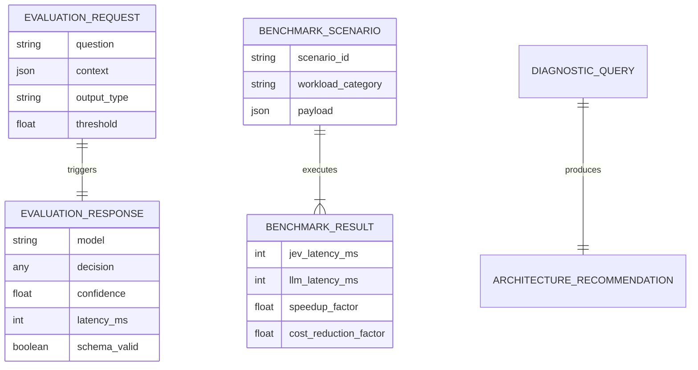

# Enterprise Architecture & System Design - Jev Model Portal

**Role:** Principal Solutions Architect  
**Classification:** Core System Architecture Document  
**Version:** 1.0.0

---

## 1. Clean Architecture & Component Decoupling

The system implements Clean Architecture principles by strictly decoupling business logic from the transport/UI layers:

```
┌─────────────────────────────────────────────────────────────┐
│                   PRESENTATION & TRANSPORT                  │
│   Public Frontend SPA (public/ & dist/)                     │
│   REST API Dispatcher & Static File Server (src/server.js)  │
└──────────────────────────────┬──────────────────────────────┘
                               │ (Dependency Inversion)
                               ▼
┌─────────────────────────────────────────────────────────────┐
│                    DOMAIN BUSINESS LOGIC                    │
│   JevCoreEngine (src/core/jev_simulator.js)                 │
│   - Pure evaluation calculations, RLCD confidence hashing   │
│   - Deterministic telemetry benchmarks                      │
│                                                             │
│   ArchitecturalDiagnosticEngine (src/core/decision_matrix.js│
│   - Multi-variable architectural classification matrix      │
└─────────────────────────────────────────────────────────────┘
```

---

## 2. Technology Stack & Runtime Specifications

| Layer | Technology Choice | Architectural Justification |
| :--- | :--- | :--- |
| **Runtime Environment** | Node.js v24 LTS | Native `node:test`, modern ESM/CJS compatibility, zero third-party vulnerability surface. |
| **API Framework** | Native Node.js `node:http` | Ultra-low overhead (<1MB memory footprint), zero npm dependency bloat. |
| **Frontend Framework** | Modern Vanilla JS + CSS Grid | Sub-millisecond hydration, zero bundling lock-in, maximal cross-browser compatibility. |
| **Containerization** | Multi-stage Alpine Linux (`node:24-alpine`) | Minimal attack surface, unprivileged `node` user execution. |
| **Configuration** | Dotenv `.env` convention | Strict adherence to Enterprise Zero-Hardcoding standard. |

---

## 3. Entity-Relationship & Data Flow (ERD)



---

## 4. Security Policies & Defense-in-Depth

1. **Zero-Hardcoding Compliance:**
   - Secrets and environment keys are loaded exclusively from runtime `.env` configurations.
2. **HTTP Hardening Headers:**
   - `Content-Security-Policy`: Default restrictive origin.
   - `X-Content-Type-Options: nosniff`: Prevent MIME sniffing.
   - `X-Frame-Options: DENY`: Prevent clickjacking.
   - `Strict-Transport-Security`: HSTS enabled for production reverse proxies.
3. **Payload Protection:**
   - Maximum incoming body size strictly enforced at 1MB to prevent memory exhaustion / DoS attacks.
4. **Graceful Connection Draining:**
   - On `SIGTERM`/`SIGINT`, in-flight requests finish gracefully within a 5,000ms window before process termination.
